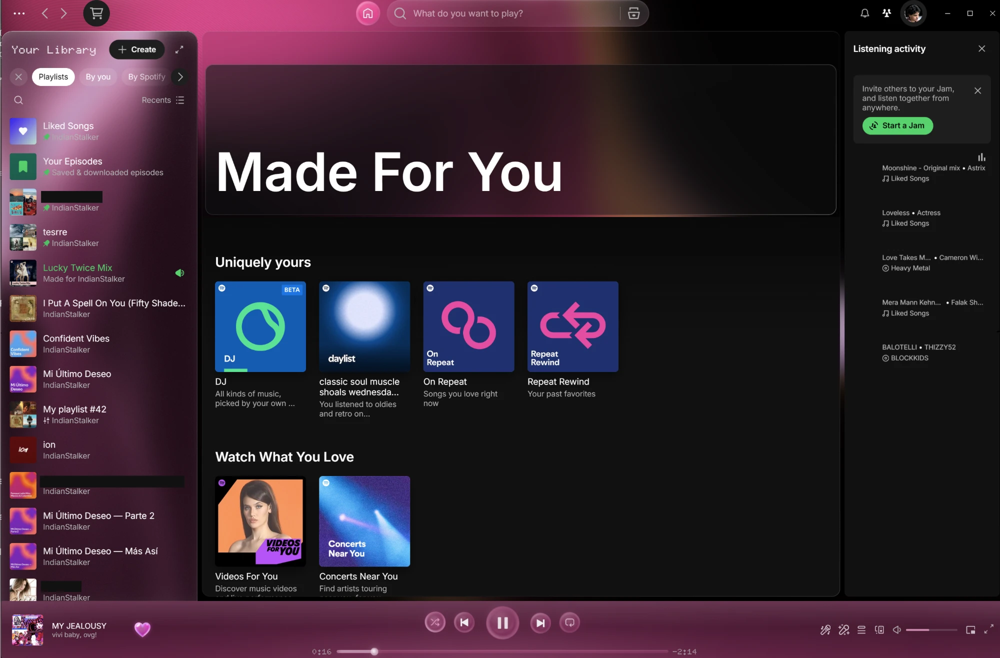

# Pyaar, Made with Love <3

**Glass and light, colored by every song.**

Pyaar is a soft, moving theme for [Spicetify](https://spicetify.app). Every color in it comes from the cover of the song that's playing, and it changes gently with each new track.



## Features

- **Colors from the music:** the whole theme takes its colors from the current song's cover, and cross-fades when the song changes.
- **Moving light:** a slow light plays across black glass behind the center and the top bar. It can follow the song's tempo if you want.
- **Liquid glass library:** a flowing ribbon of liquid glass sits behind a frosted glass library panel.
- **Glass controls:** play, skip, shuffle, repeat and Home are milky glass pearls that float and shimmer.
- **Soft search bar:** a milky glass pill that wakes softly when you hover it and glows like a cloud when you type.
- **Glass heart:** the like button is a thick glass heart that bends the light behind it. It glides and catches a glare when you hover it, and turns pink glass when you like a song.
- **Glass pages:** home and playlist pages sit in frosted glass boxes.
- **Music sync (optional):** the library's light follows the song's tempo, bass, build-ups and drops.

---

<div align="center">

### 💌 Developer note

*This is a Personal Project. I plan on adding more features. Making it more prettier.*

*I found other themes to either too dull or goes too overboard,*

### Ultimately I've made this with love. 🤍

</div>

---

## Installing

### Spicetify Marketplace (recommended)

1. Open **Marketplace** in Spotify.
2. Go to **Themes** and search for **Pyaar**.
3. Click **Install**.

### Manually

1. Download this repository and copy the `Pyaar` folder into your Spicetify `Themes` folder (run `spicetify path userdata` to find it).
2. Run:

   ```bash
   spicetify config current_theme Pyaar color_scheme Dark inject_css 1 replace_colors 1 inject_theme_js 1
   spicetify apply
   ```

## Settings

Click your profile picture and choose **Pyaar Settings**:

- **Music sync:** off by default. Turn it on to make the library's light move with the music.
- **Sync intensity:** Subtle, Normal or Strong.
- **Center light:** turn the moving light behind the center on or off.
- **Follow the tempo:** off by default. The center light moves faster or slower with the song's tempo.

## Good to know

- **Music sync** and **Follow the tempo** use Spotify's audio analysis for each song. It isn't available for local files, podcasts or some very new releases; the light stays calm for those.
- Pyaar styles parts of Spotify's interface that Spotify can change at any time, so an update to Spotify may break some details until the theme is updated.
- Tested with Spicetify 2.45.1 on Windows.

## License

Copyright © 2026 IndianStalker. **All rights reserved.**

You're welcome to install and use Pyaar. You may not copy, modify, reuse or redistribute its code or designs. See [LICENSE](LICENSE).

Not affiliated with or endorsed by Spotify.

Made with love <3
